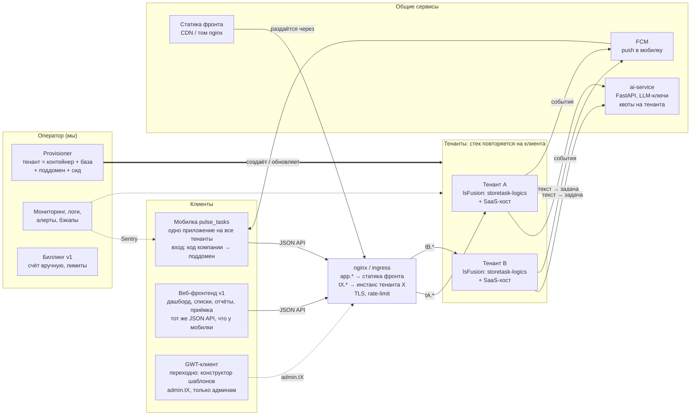
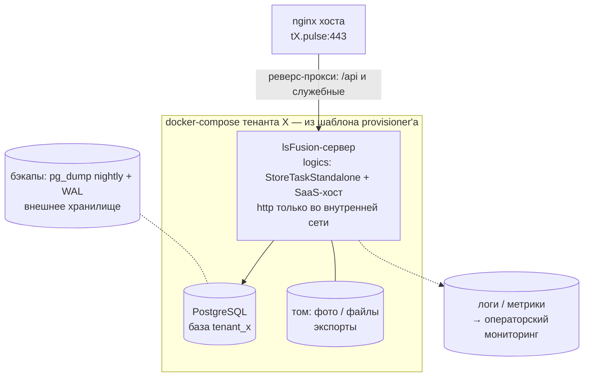
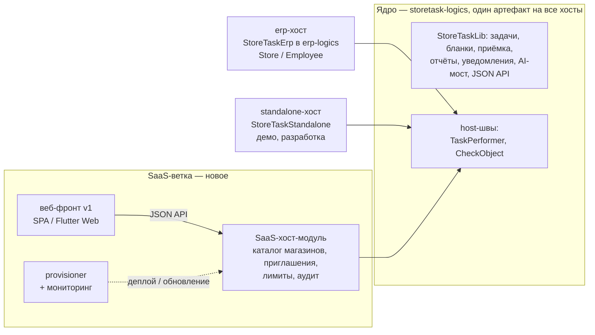
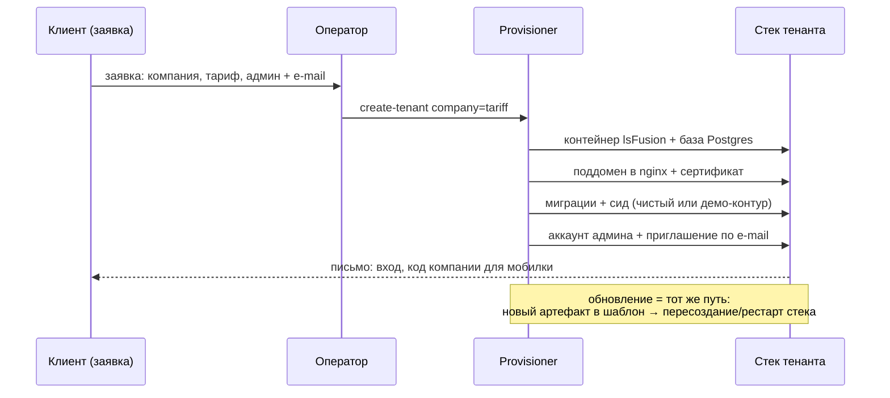
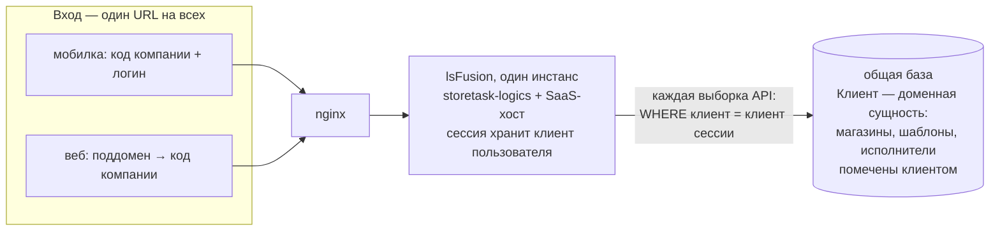
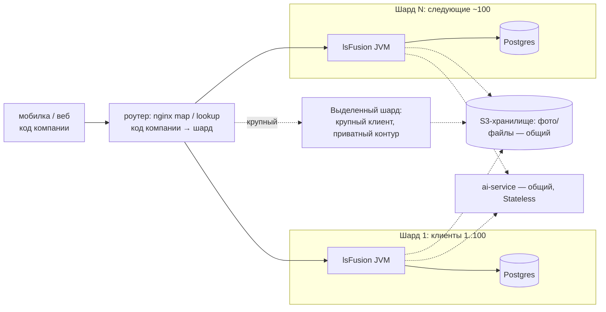

# Устройство SaaS-версии: схемы

Черновик (2026-10-11). Сценарии — в [saas-scenarios.md](saas-scenarios.md);
здесь — как это выглядит в железе/контейнерах. Схемы Mermaid: рендерятся на
GitHub и в IDEA (плагин), в чистом виде читаются как текст.

Решения, зашитые в схемы:

- **Изоляция: клиент — доменная сущность, скоуп — на сервере.** Ядро не знает
  про тенантов; SaaS-хост вводит «Клиента» и помечает корневые сущности
  (магазины, шаблоны, исполнители). Клиент определяется при логине (код
  компании) и хранится в сессии; каждая выборка API наследует скоуп из сессии.
  Фильтр на фронте — только UX, не изоляция. Физическая компоновка при этом —
  режим деплоя: общая база (схема 6) или инстанс+база на клиента (схемы 1–2);
  одно и то же ядро, выделенный инстанс крупному клиенту — продаётся как
  «приватный контур».
- **Один JSON API-контракт на два фронта** (мобилка + веб). Веб v1 ничего
  своего на бэке не требует, кроме недостающих ручек дашборда.
- **GWT-клиент — переходный** внутренний инструмент (конструктор шаблонов),
  наружу не экспонируется, из прода выдавливается постепенно.
- **Версия платформы зафиксирована** (не SNAPSHOT), единый протестированный
  артефакт storetask-logics на все тенанты.

## 1. Общая схема контура

## 2. Стек одного тенанта

## 3. Ядро и хосты: один артефакт — три хоста, SaaS не форк

erp-линия (встраивание в крупные заказчики) и SaaS-линия живут на одном ядре:
фикс в ядре доезжает в оба канала поставки, ничего не форкается.

## 4. Жизненный цикл тенанта: провижининг

Self-service signup (A1 без оператора) — та же последовательность, запуск
кнопкой после ручной обкатки на первых клиентах.

## 5. Что где живёт в кодовой базе

| слой | где | статус |
|---|---|---|
| Ядро (задачи, бланки, API, уведомления, AI-мост) | `src/main/lsfusion` | не трогаем; SaaS не требует изменений ядра |
| SaaS-хост-модуль (магазины, приглашения, лимиты) | новый модуль рядом с `StoreTaskStandalone` | новое; начать здесь, в отдельный репо выделять при стабилизации |
| Веб-фронт v1 | отдельный репо (SPA или Flutter Web поверх существующего кода pulse_tasks) | новое |
| Provisioner, мониторинг, биллинг-учёт | отдельный репо `saas-ops` | новое |
| ai-service | уже отдельный сервис `ai-service/` | доработать квотами на тенанта |
| Мобилка | `mobile/pulse_tasks` | доработать флоу входа «код компании → поддомен» |

## 6. Вариант «общая база»: несколько клиентов в одном инстансе

Клиент — обычная доменная сущность; разделение делает не инфраструктура,
а серверный скоуп каждой выборки. Один API-URL на всех, клиент резолвится
при логине и едет в сессии.

Точки, где скоуп обязателен (чек-лист ревью):

- конвенция ApiCommon: клиент берётся из сессии, никогда из параметров запроса;
- списки/дашборды/отчёты — все «менеджерские» ручки (пачка по критериям —
  критерии только по объектам клиента);
- админ-справочники (шаблоны, люди, объекты) — только через новый веб-фронт,
  GWT-клиент — инструмент оператора;
- гипотезы и расписания — шаблоны клиента; AI-создание задачи — клиент автора;
- нумератор задач (ST000385 глобален) — последовательность на клиента;
- логины уникальны в рамках клиента (вход с кодом компании);
- автостраховка: скрипт-гейт «ручка без клиентского скоупа», по образцу
  pre-commit-проверки `.lsf`.

Плюсы: одна JVM и одна база вместо N стека (экономика мелких клиентов),
один nginx без роутинга по поддоменам, одно обновление, задел на кросс-клиентские
фичи (бенчмарки по рынку, общая библиотека шаблонов).

Цена: нет платформенной страховки — security-политии платформы управляют
доступом к формам/свойствам навигатора, а не строками, так что забытый фильтр
= утечка между клиентами; noisy neighbor (тяжёлый отчёт одного клиента бьёт по
всем); восстановление/удаление одного клиента — хирургия по таблицам; единый
blast radius обновлений.

Связка с моделями выше: клиент как доменная сущность нужен в обеих компоновках
(сиды, биллинг, метрики). Поэтому стартовать можно на общей базе, а выделенные
инстансы давать точечно крупным клиентам («приватный контур») — код один,
компоновка — режим деплоя.

## 7. Масштабирование

Единица масштаба — **шард**: стек «lsFusion JVM + Postgres» из одного
docker-шаблона, внутри которого живут десятки-сотни клиентов. Растём вширь
шардами, а не наращиванием одного кластера: документированной кластеризации
app-серверов с балансировкой у платформы нет (сессии и RMI-клиенты привязаны
к инстансу). Клиент — атомарная единица: целиком на одном шарде, кросс-клиентских
транзакций в продукте нет, поэтому шардирование чистое.

Оценка ёмкости (якоря, не обещания):

- erp на lsFusion крутится на предприятиях с **500+ одновременно работающими
  пользователями** на одном инстансе; наш продукт легче erp по логике;
- бенч-стенд rtmperf: 20 тыс. объектов проверки на инстансе; 100 малых клиентов
  (до ~5 магазинов) — это лишь ~500 объектов, т.е. по данным запас в разы;
- рекомендация платформы: `-Xmx` от 4 ГБ на сложную логику; для нагруженных —
  `CMSInitiatingOccupancyFraction` 40–60 (платформа по нему подстраивает
  LRU-кэши).

Вывод: **100 малых клиентов на шард — реалистично**, сотни — вероятно по
железу; реальные ограничители наступают раньше по сопровождению, не по CPU:

- окно обновления бьёт сразу по всем клиентам шарда → канареечный шард,
  затем волна; бета-клиенты по желанию;
- шумные соседи: тяжёлый отчёт одного клиента бьёт по всем → per-client
  rate-limit на nginx, таймауты отчётов, лимит доставок (уже есть, #37498);
- объём фото — главный драйвер хранения → фото/файлы в S3 с самого начала,
  не в базу;
- фоновые задачи (график генерации, прогоны гипотез всех клиентов шарда):
  дефолт планировщика — 5 потоков, поднять и задать «Perform no longer than»
  на задачи, чтобы один клиент не monopolизировал пул.

Средние клиенты (20–50 магазинов) — единицы-десятки на шард; крупные —
выделенный шард (продаётся как «приватный контур»). Миграция клиента между
шардами = экспорт/импорт (тот же механизм, что сценарий A5).

Что платформа даёт для подстраховки: управление репликами базы
(DBMaster/DBSlave, форма scaling, мониторинг lag/нагрузки) — отказоустойчивость
и тяжёлые чтения оператора, но не способ масштабировать API-трафик: инстанс
логики остаётся один на шард.

Триггеры заведения нового шарда (порог ~60–70%): p95 API, heap/GC-паузы,
IO базы, лаги очередей уведомлений. Кросс-клиентские фичи (бенчмарки по рынку)
при нескольких шардах — только через экспорт метрик в операторский контур,
не SQL-джойнами между базами.
